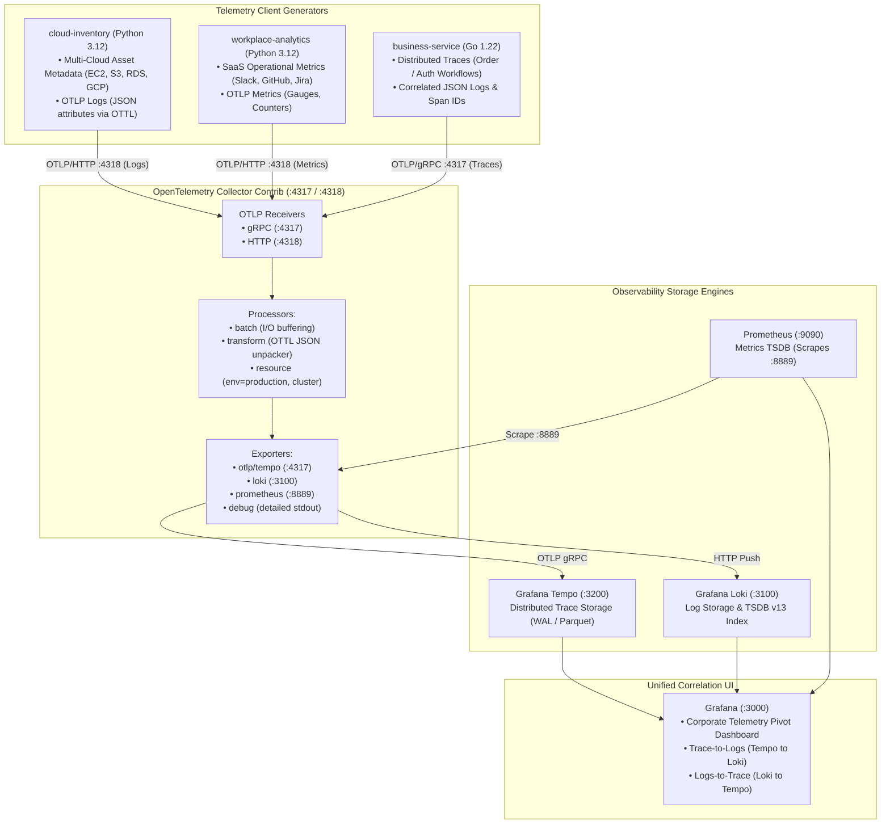
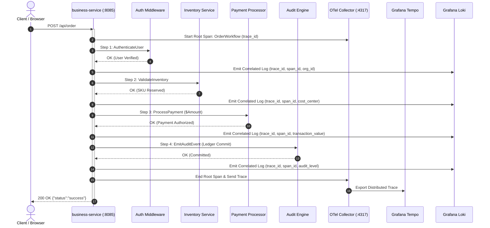
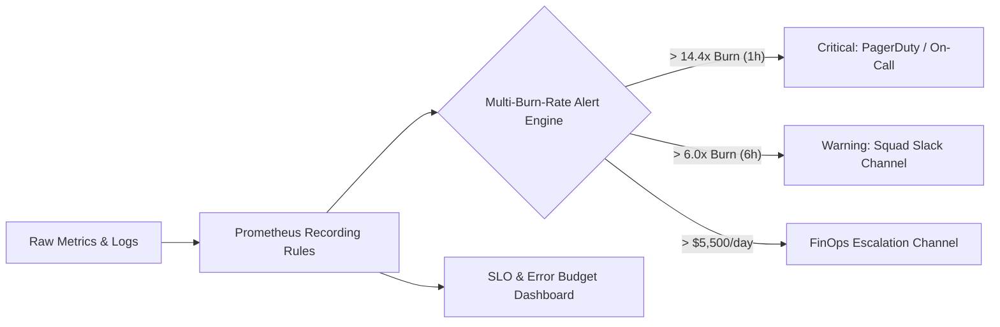

# Korel — Enterprise Corporate Telemetry & Correlation Platform

[](https://github.com/cchostak/korel/actions/workflows/ci.yml)
[](https://github.com/cchostak/korel/actions/workflows/security.yml)
[](LICENSE)
[](https://opentelemetry.io/)
[](https://golang.org)
[](https://python.org)

A unified, multi-source **Corporate Telemetry and Correlation Platform** engineered with **OpenTelemetry (OTel)**, **Grafana**, **Tempo**, **Loki**, and **Prometheus**.

Korel serves as an enterprise ingestion, enrichment, and correlation engine—not just for traditional distributed traces and service logs, but for **arbitrary corporate operational telemetry**: multi-cloud infrastructure assets (AWS/GCP inventory, compliance, egress spend), SaaS workplace velocity metrics (Slack active users, GitHub PR throughput, Jira ticket backlogs), and distributed business transactions.

---

## 1. Architecture Overview



### Distributed Transaction Sequence



---

## 2. Directory Structure

```text
.
├── .editorconfig                   # Standardized editor indentation and formatting rules
├── .gitattributes                  # LF line-ending normalization & linguist flags
├── .gitignore                      # Ignore patterns for artifacts, coverage, and caches
├── .pre-commit-config.yaml         # Pre-commit hooks (Gitleaks, yamllint, markdownlint, Hadolint)
├── catalog-info.yaml               # Backstage Service Catalog Component Entity
├── CODEOWNERS                      # Repository path ownership and review routing
├── CONTRIBUTING.md                 # Contributor guidelines, branch conventions, commit standards
├── docker-compose.yml              # Multi-container orchestration definition
├── LICENSE                         # Apache-2.0 open-source license
├── Makefile                        # Ergonomic developer commands (check, fmt, test, doctor, etc.)
├── README.md                       # Comprehensive platform guide and architectural reference
├── SECURITY.md                     # Vulnerability reporting policy & security standards
├── .github/
│   ├── dependabot.yml              # Automated weekly dependency updates for Go, Python, Docker, Actions
│   └── workflows/
│       ├── ci.yml                  # Linting, unit tests, container builds, and integration smoke tests
│       └── security.yml            # Gitleaks secret auditing, Trivy scans, and Go vulnerability checks
├── config/
│   ├── otel-collector-config.yaml  # OpenTelemetry Collector Contrib pipelines & OTTL transforms
│   ├── prometheus.yml              # Prometheus scraping configuration
│   ├── loki-config.yaml            # Grafana Loki storage & TSDB index configuration
│   ├── tempo-config.yaml           # Grafana Tempo monolithic trace configuration
│   └── grafana/
│       ├── provisioning/
│       │   ├── datasources/datasources.yaml  # Auto-provisioned Tempo, Loki, Prometheus datasources
│       │   └── dashboards/dashboards.yaml    # Dashboard provider definitions
│       └── dashboards/
│           └── corporate-telemetry-pivot.json # Corporate Telemetry Pivot correlation dashboard
├── clients/
│   ├── cloud-inventory/            # Python client generating multi-cloud asset logs
│   │   ├── Dockerfile
│   │   ├── requirements.txt
│   │   └── main.py
│   ├── workplace-analytics/        # Python client generating SaaS operational metrics
│   │   ├── Dockerfile
│   │   ├── requirements.txt
│   │   └── main.py
│   └── business-service/           # Go service generating distributed order/auth traces
│       ├── Dockerfile
│       ├── go.mod
│       ├── go.sum
│       ├── main.go
│       └── main_test.go
├── docs/
│   └── adr/                        # Architecture Decision Records
│       ├── 0001-record-architecture-decisions.md
│       └── 0002-core-architecture-and-stack.md
└── tests/
    ├── smoke_test.sh               # Executable end-to-end integration and health verification suite
    ├── run_all.sh                  # Master test orchestrator for unit & smoke tests
    └── unit/                       # Python unit tests for telemetry generators
        ├── test_cloud_inventory.py
        └── test_workplace_analytics.py
```

---

## 3. Unified Resource Taxonomy

All telemetry emitted across the platform is enriched with standardized corporate resource attributes:

| Attribute | Scope | Description | Example Values |
| :--- | :--- | :--- | :--- |
| `org_id` | Resource Attribute | Organization or tenant boundary | `corp-acme-prod`, `corp-acme-staging` |
| `cost_center` | Resource / Log / Span | Departmental budget identifier | `engineering-core`, `payments-infra`, `data-platform`, `security-ops` |
| `service_owner` | Resource / Log / Span | Engineering squad responsible for asset | `sre-team`, `checkout-squad`, `analytics-infra`, `sec-ops` |
| `environment` | Resource Attribute | Lifecycle tier | `production`, `staging`, `development` |
| `cluster` | Resource Attribute | Compute cluster location | `corp-central-01` |

---

## 4. Quickstart (< 5 Minutes)

### Prerequisites
- Docker (20.10+) & Docker Compose (v2.0+)
- `curl`, `jq`, GNU `make`

### 1. Verify Development Environment
```bash
make doctor
```

### 2. Initialize Configuration
```bash
make init
```
Generates `.env` from `.env.example`.

### 3. Launch the Telemetry Platform
```bash
make up
```
Builds all client images and boots all 8 containers in detached mode.

### 4. Verify Platform Health & Run Smoke Tests
```bash
make test-smoke
```

### 5. Access Observability Interfaces
```bash
make observe
```

| Service | URL | Default Credentials | Description |
| :--- | :--- | :--- | :--- |
| **Grafana** | [http://localhost:3000](http://localhost:3000) | `admin` / `admin` | Unified Observability Dashboards |
| **Prometheus** | [http://localhost:9090](http://localhost:9090) | None | Metrics TSDB & PromQL Interface |
| **Tempo** | [http://localhost:3200](http://localhost:3200) | None | Distributed Tracing HTTP Backend |
| **Loki** | [http://localhost:3100](http://localhost:3100) | None | Structured Log Storage Engine |
| **OTel Collector** | [http://localhost:8888](http://localhost:8888) | None | Collector Internal Health & Metrics |
| **Business API** | [http://localhost:8085](http://localhost:8085) | None | Transaction Triggering Endpoint |

---

## 5. Configuration Reference

All environment variables can be configured in `.env`:

| Variable | Default Value | Description |
| :--- | :--- | :--- |
| `GRAFANA_PORT` | `3000` | Host port for Grafana web UI |
| `PROMETHEUS_PORT` | `9090` | Host port for Prometheus web UI and API |
| `TEMPO_PORT` | `3200` | Host port for Grafana Tempo HTTP API |
| `LOKI_PORT` | `3100` | Host port for Grafana Loki HTTP API |
| `OTEL_COLLECTOR_GRPC_PORT` | `4317` | OTLP gRPC receiver port on OTel Collector |
| `OTEL_COLLECTOR_HTTP_PORT` | `4318` | OTLP HTTP receiver port on OTel Collector |
| `OTEL_COLLECTOR_METRICS_PORT`| `8888` | Internal collector health and metric port |
| `OTEL_COLLECTOR_PROMETHEUS_PORT`| `8889` | Prometheus metrics exporter port on Collector |
| `BUSINESS_SERVICE_PORT` | `8085` | Host port for Business Service API |
| `GRAFANA_ADMIN_USER` | `admin` | Default Grafana administrator username |
| `GRAFANA_ADMIN_PASSWORD` | `admin` | Default Grafana administrator password |
| `ORG_ID` | `corp-acme-prod` | Corporate tenant identifier injected into telemetry |
| `ENVIRONMENT` | `production` | Deployment environment tier |
| `INVENTORY_INTERVAL` | `10` | Interval (seconds) between Cloud Inventory scans |
| `WORKPLACE_INTERVAL` | `10` | Interval (seconds) between Workplace Metrics emissions |

---

## 6. Corporate Observability Dashboard Suite

All dashboards are provisioned in `/etc/grafana/provisioning/dashboards/` and organized under the **Corporate Observability** folder:

| Dashboard | File | UID | Key Visualizations & Telemetry |
| :--- | :--- | :--- | :--- |
| **1. Corporate Telemetry Pivot** | `corporate-telemetry-pivot.json` | `corporate-telemetry-pivot` | Executive overview across all 3 pillars: SaaS Workplace KPIs, FinOps spend, real-time Cloud asset stream, RED transaction metrics, Correlated Logs with Tempo trace deep links. |
| **2. Multi-Cloud Infrastructure & Compliance** | `cloud-infrastructure-inventory.json` | `cloud-infrastructure-inventory` | AWS/GCP asset breakdown, compliance states (compliant/warning/non-compliant), encryption status, instance shapes, regional heatmaps, daily/monthly egress cost calculations, and live Loki event streams. |
| **3. Workplace & Engineering Velocity** | `workplace-engineering-velocity.json` | `workplace-engineering-velocity` | Slack active users by department/cost center, GitHub open PRs vs merge throughput, Jira issue backlogs, and cross-team collaboration velocity. |
| **4. Business Transactions & Distributed Tracing APM** | `business-transactions-apm.json` | `business-transactions-apm` | RED transaction metrics, workflow durations (p50/p90/p95/p99), step-by-step latency breakdown (`AuthenticateUser`, `ValidateInventory`, `ProcessPayment`, `EmitAuditEvent`), and correlated Loki log table with clickable Tempo trace view. |
| **5. OTel Collector & Pipeline Health** | `otel-collector-pipeline.json` | `otel-collector-pipeline` | Ingestion rates (spans/metrics/logs per sec), export delivery rates, batch processor sizes, receiver drops, queue capacity/size, memory RSS, and CPU utilization. |
| **6. SLOs, SLAs & Error Budgets** | `slo-sla-error-budgets.json` | `slo-sla-error-budgets` | 99.9% Availability SLA gauges, 7-day/30-day remaining error budgets, Google SRE multi-window multi-burn-rate tracking (1h/6h), latency QoS percentiles (<250ms), and real-time active firing alerts table. |

### Pivoting & Cross-Telemetry Correlation
1. Open **Grafana** at [http://localhost:3000](http://localhost:3000) (`admin`/`admin`).
2. Navigate to **Dashboards** $\rightarrow$ **Corporate Observability**.
3. Use the template variables at the top (`Cost Center`, `Service Owner`, `Org ID`, `Environment`) to filter across all three observability pillars simultaneously:
   - **Workplace Metrics:** Inspect Slack active users, open PR throughput, and daily cloud costs for the selected team.
   - **Cloud Inventory Stream:** Review real-time asset discoveries, IAM policies, and compliance statuses for the team's cloud infrastructure.
   - **Distributed Traces & Latency:** Inspect transaction latency waterfalls and click on correlated log entries to jump directly into Grafana Tempo using the extracted `trace_id`.

### Triggering Manual Distributed Transactions
To trigger a live distributed transaction trace:
```bash
make test-trace
```
Or directly via curl:
```bash
curl -s -X POST http://localhost:8085/api/order | jq .
```

---

## 7. Service Level Objectives (SLOs), SLAs & Alerting

Korel enforces a **multi-window multi-burn-rate SRE alerting architecture** across four core pillars:



### Core Commitments & Targets
| Category | Metric / Objective | Target | Breach Threshold | Escalation Route |
| :--- | :--- | :--- | :--- | :--- |
| **Availability SLA** | Order Workflow Success Rate | **99.9%** (30d) | 14.4x burn rate in 1h | `corporate-oncall-pager` (Critical) |
| **Latency SLO** | Order Execution Latency | **95% $\le$ 250ms** | p95 > 350ms for 3m | `corporate-sre-team` (Warning) |
| **FinOps Cost Cap** | Estimated Daily Cloud Spend | **$\le$ $5,000/day** | > $5,500 warning / $6,500 critical | `corporate-finops-alerts` |
| **Telemetry Ingestion** | OTel Collector Loss | **0% dropped** | Refused Spans > 0 | `corporate-sre-team` (Critical) |
| **Workplace GRC** | Urgent Incident Backlog | **$\le$ 20 tickets** | > 35 urgent tickets | `corporate-sre-team` (Warning) |

All alert rules and contact points are provisioned in `config/prometheus-rules.yml` and `config/grafana/provisioning/alerting/alerting.yaml`. Full mathematical formulations and design decisions are documented in [ADR 0003](docs/adr/0003-slo-sla-and-alerting-architecture.md).

---

## 8. Developer & Operational Commands

| Command | Description |
| :--- | :--- |
| `make doctor` | Validates required CLI tools, Docker daemon, and `.env` configuration |
| `make check` | Runs non-modifying linters and static analysis (Go, Python, YAML, Shell) |
| `make fmt` | Auto-formats code and manifests across the repository |
| `make test` | Executes the complete test suite (unit + smoke tests) |
| `make test-unit` | Runs Go and Python unit tests |
| `make test-smoke` | Runs end-to-end integration smoke tests against running containers |
| `make scan` | Executes local vulnerability and secret scans (Gitleaks, Trivy, Go vuln) |
| `make up` | Builds and launches all 8 telemetry containers in the background |
| `make down` | Stops all containers and purges storage volumes |
| `make restart` | Restarts all platform services |
| `make status` | Displays container health status and port bindings |
| `make logs` | Streams live logs from the OpenTelemetry Collector |
| `make logs-all` | Streams live logs from all containers |
| `make clean` | Removes built images, temporary files, and `.env` |

---

## 8. Troubleshooting & Diagnostics

### 1. Port Conflict (`Bind for 0.0.0.0:<PORT> failed: port is already allocated`)
- Check which process is occupying the port:
  ```bash
  sudo lsof -i :<PORT>
  ```
- Override the conflicting port in your `.env` file (e.g., change `GRAFANA_PORT=3001`).

### 2. OTel Collector Not Exporting Metrics to Prometheus
- Check collector health:
  ```bash
  curl http://localhost:8888/
  ```
- Verify the Prometheus exporter endpoint:
  ```bash
  curl http://localhost:8889/metrics
  ```
- Check OTel Collector live logs for pipeline errors:
  ```bash
  docker compose logs otel-collector
  ```

### 3. Missing Traces in Grafana Tempo
- Verify Tempo readiness:
  ```bash
  curl http://localhost:3200/ready
  ```
- Generate a fresh transaction trace:
  ```bash
  make test-trace
  ```
- Ensure `clients/business-service` can reach `otel-collector:4317` over the `telemetry-net` bridge network.

### 4. Container Resource Allocation
If containers exit unexpectedly during peak simulation load, verify Docker daemon memory allocation (`docker stats`). Recommended minimum local Docker resources: **4 CPUs / 8 GB RAM**.
