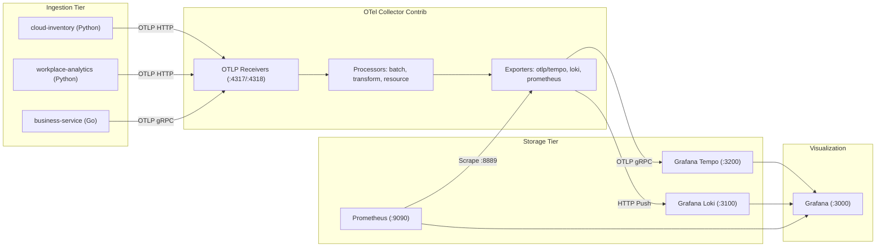

# 2. Core Architecture, Telemetry Pipeline & Observability Stack

Date: 2026-08-29

## Status

Accepted

## Context

Enterprise environments require observability that bridges the gap between infrastructure metrics, application transactions, and organizational telemetry (e.g., cloud inventory spend, Slack activity, GitHub PR throughput, and Jira ticket volumes). 

Traditional monitoring stacks fragment these signals across disconnected silos:
1. Application APM and distributed traces reside in proprietary tracing backends.
2. Infrastructure logs and security events reside in separate log management platforms.
3. SaaS and engineering velocity metrics reside only in third-party dashboards.

We need a unified, vendor-neutral telemetry architecture capable of ingesting arbitrary corporate telemetry, enriching it with standardized organizational dimensions, and enabling bi-directional correlation between traces, logs, and metrics.

## Decision

We adopt a **Unified OpenTelemetry (OTel) and Grafana LGTM/P (Loki, Grafana, Tempo, Prometheus)** architecture:

### 1. Unified Ingestion Layer
- **OpenTelemetry Collector Contrib**: Deployed as the central gateway listening on `:4317` (gRPC) and `:4318` (HTTP).
- **Processors**:
  - `transform`: Utilizes OpenTelemetry Transformation Language (OTTL) to dynamically unpack nested JSON payloads from log records into first-class searchable attributes (`org_id`, `cost_center`, `service_owner`, `resource_type`, `egress_cost_monthly`).
  - `resource`: Enriches all telemetry streams with global deployment attributes (`deployment.environment=production`, `cluster=corp-central-01`).
  - `batch`: Buffers telemetry to optimize network I/O and backend ingestion throughput.

### 2. Specialized Storage Backends
- **Grafana Tempo (`:3200`)**: Monolithic trace storage engine ingesting OTLP spans from the collector and generating service graphs and span metrics.
- **Grafana Loki (`:3100`)**: Single-binary log storage utilizing TSDB index v13 and structured metadata to store high-cardinality corporate log streams without prohibitive indexing overhead.
- **Prometheus (`:9090`)**: Time-series database scraping the OpenTelemetry Collector's Prometheus exporter endpoint (`:8889`) to retain gauge and counter metrics.

### 3. Unified Correlation & Visualization
- **Grafana (`:3000`)**: Pre-provisioned with data sources (Tempo, Loki, Prometheus) and the **Corporate Telemetry Pivot Dashboard**.
- **Trace-to-Logs Correlation**: Configured in Tempo datasource linking trace spans to corresponding Loki logs filtered by `trace_id` and service tags.
- **Logs-to-Trace Correlation**: Configured in Loki datasource using regex derived fields extracting `trace_id` from JSON log streams and linking directly to Tempo trace waterfall views.

### 4. Standardized Corporate Resource Taxonomy
All telemetry emitted across the platform must adhere to the core attribute model:
- `org_id`: Tenant or organizational boundary (e.g., `corp-acme-prod`).
- `cost_center`: Financial cost allocation unit (e.g., `engineering-core`, `payments-infra`).
- `service_owner`: Engineering squad responsible for service/asset lifecycle.
- `environment`: Operational tier (`production`, `staging`, `development`).

## Consequences

### Positive
- **Zero Silos**: Engineering velocity, cloud asset compliance, and distributed application traces are correlated in a single pane of glass.
- **Vendor Neutrality**: Telemetry generation relies strictly on open OpenTelemetry SDKs (Go and Python).
- **High Observability Fidelity**: Deep drill-downs from high-level cost/velocity metrics to individual distributed transaction traces.

### Negative / Trade-offs
- **Collector Processing Overhead**: OTTL transforms in the collector add slight CPU load during high log volume ingestion.
- **Multi-Container Topology**: Managing 8 containerized services requires robust orchestration and automated health monitoring.
